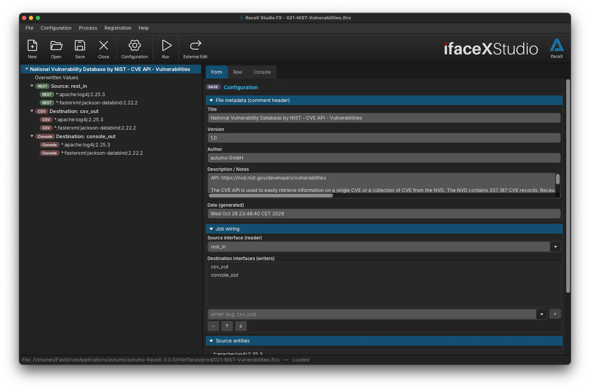

  

<h1 align="center" style="font-size:3.5em; margin:0px">autumo UI</h1>

 

# ifaceX Studio

ifaceX studio FX is used to develop, create, and test interface processor
configurations (IPCs) for the [autumo ifaceX](https://ifacex.autumo.ch)
data integration and exchange platform.

You find [here](https://github.com/autumoswitzerland/autumo-ifacex-studio-fx-public/releases)
the ifaceX Studio installers for Windows, macOS, and Linux:

* **Linux**: `ifaceX-Studio-FX-3.0.0-linux-x64.deb`
* **macOS (Apple Silicon):**: `ifaceX-Studio-FX-3.0.0-macos-arm64.pkg`
* **macOS (Intel):**: `ifaceX-Studio-FX-3.0.0-macos-x64.pkg`
* **Windows:**: `ifaceX-Studio-FX-3.0.0-windows-x64.exe` and `ifaceX-Studio-FX-3.0.0-windows-x64.msi`

For further information, download the [ifaceX Studio Manual](https://products.autumo.ch/ifacex/download).

## Features

- **Integration Development**: ifaceX Studio FX provides tools for developing and testing IPCs for integrations between various clouds, systems and applications, enabling data exchange and process automation.
- **Graphical User Interface**: The software includes a user-friendly GUI that allows users to design IPCs visually, reducing the need for coding.
- **Predefined writers/readers**: Predefined writers/readers (connectors) for common formats and services simplify the integration process; load and use predefined IPC templates connected to Clouds, PayPal, Hubspot, Swift, Thomson Reuters, Stripe and others. load and use predefined IPC templates connected to Clouds, PayPal, Hubspot, Swift, Thomson Reuters, Stripe and others.
- **Debugging and Testing**: Users can debug and test their integrations within the studio, ensuring reliability before deployment.
- **Data Transformation**: The tool supports data transformation capabilities, allowing users to transform, manipulate and convert data as it moves between systems.
- **Workflow Management**: ifaceX Studio includes features for managing workflows, helping to orchestrate complex integration scenarios.
- **Documentation and Support**: Comprehensive documentation is provided, along with support resources to assist users during the development process.
- **Additional Tools**: ifaceX license registration, password encryption of all sensitive data, basic platform configurations.
- **autumo ifaceX Features**:
    - Data Integration
    - ETL (Extract, Transform, Load)
    - Data Transformation
    - Big Data Processing
    - API Management and Integration
    - Enterprise Service Bus (ESB)
    - Monitoring, Reporting and Alerting
    - Automation and Workflow Orchestration
    - Hybrid Cloud Integration Platforms			

 

  

